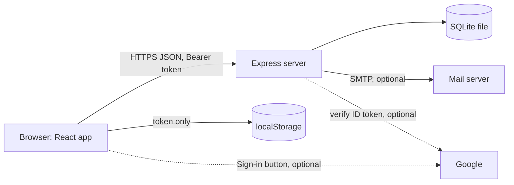
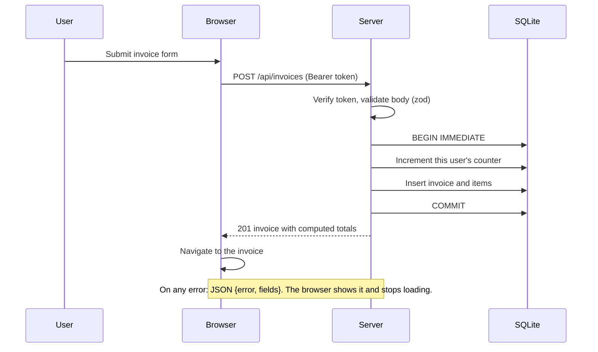

# Architecture

The browser never talks to the database. PDFs are produced inside the server process and streamed back in the same response. Nothing is written to disk except the SQLite file.

## Components

| Box | Files | Does |
|---|---|---|
| React app | `client/src/App.jsx`, `pages/*` | Routes, forms, dashboard. Public pages (`/`, `/signin`, `/signup`, `/forgot`, `/reset/:token`) and a protected `/app/*` shell |
| API client | `client/src/api.js` | Adds the bearer token, turns failures into `ApiError(message, status, fields)`, signs out on a 401 |
| Auth state | `client/src/auth.jsx` | Holds the user, restores the session through `/auth/me` |
| Express app | `server/src/app.js` | All routes, validation, security headers, rate limits, error handler |
| Auth middleware | `server/src/auth.js` | Verifies the JWT (HS256), confirms the user still exists, sets `req.userId` |
| Schemas | `server/src/schemas.js` | Zod validation of every request body |
| Money | `server/src/money.js` | Totals and status derived from items and payments, in integer cents |
| PDF | `server/src/pdf.js` | Renders an invoice into a Buffer with `pdfkit` |
| Mail | `server/src/mail.js` | `nodemailer` when `SMTP_HOST` is set, otherwise logs and reports "not delivered" |
| Database | `server/src/db.js` | SQLite via Node's built-in `node:sqlite`, schema creation, transaction helper |

## External services
- **SQLite** (a local file, `DB_PATH`).
- **SMTP** server, optional.
- **Google**, optional. The server verifies ID tokens with `google-auth-library`. The sign-in button loads Google's script only when `GOOGLE_CLIENT_ID` is set.

## Where state lives
- **SQLite:** users, clients, invoices, invoice items, payments, invoice counters, reset-token hashes.
- **Browser `localStorage`:** one key, `folio.token` (the JWT). No user record or id is stored there.
- **Server memory:** rate-limit counters only.

## Request path

## Security decisions
- Owner comes only from the verified token. Every query includes `user_id`.
- Totals and status are never stored, so they can't be tampered with. They are derived on each read.
- Reset tokens: 32 random bytes, SHA-256 hashed at rest, single-use, one-hour expiry.
- `helmet` sets a Content-Security-Policy. Auth routes are rate limited (30 per 15 minutes per IP), and sending is limited to 10 per hour per user.
