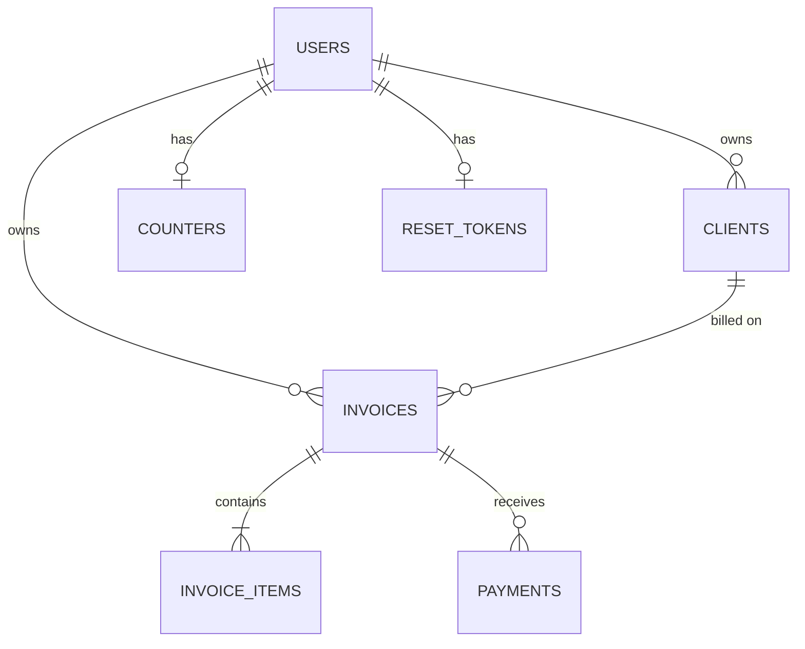

# Data model

Defined in `server/src/db.js`. SQLite with `foreign_keys = ON`.

## Entities

**users**: `id` (uuid, PK) · `email` (unique, lower-cased) · `name` · `password_hash` (null for Google-only users) · `google_sub` (unique, null if not linked) · `business_name` · `phone` · `address` · `website` · `payment_details` · `logo` (PNG/JPEG data URL, at most 400 KB) · `currency` (default `USD`) · `created_at`

**reset_tokens**: `user_id` (PK, FK users, cascade) · `token_hash` (SHA-256) · `expires_at` (epoch ms). One live token per user.

**clients**: `id` · `user_id` (FK users, cascade) · `name` · `email` · `phone` · `address` · `created_at`. Index on `user_id`.

**counters**: `user_id` (PK, FK users, cascade) · `last_number`. Incremented atomically when an invoice is created and never decremented.

**invoices**: `id` · `user_id` (FK, cascade) · `client_id` (FK clients, **restrict**) · `number` (integer) · `currency` · `issue_date` · `due_date` (ISO `YYYY-MM-DD`) · `tax_bps` (basis points, 2000 = 20%) · `notes` · `created_at`

**invoice_items**: `id` · `invoice_id` (FK, cascade) · `position` · `description` · `quantity_milli` (thousandths, 1500 = 1.5) · `unit_cents`

**payments**: `id` · `invoice_id` (FK, cascade) · `amount_cents` (**CHECK > 0**) · `paid_on` · `method` · `note` · `created_at`. Index on `invoice_id`.

## Constraints and indexes

| Constraint | Purpose |
|---|---|
| `users.email` UNIQUE | One account per email |
| `users.google_sub` UNIQUE | One Folio user per Google account |
| `invoices UNIQUE (user_id, number)` | No duplicate invoice numbers per user |
| `payments.amount_cents CHECK (> 0)` | The database refuses zero or negative payments |
| `invoices.client_id ON DELETE RESTRICT` | A client with invoices can't be deleted |
| All `user_id` and `invoice_id` FKs cascade | Deleting a user or invoice removes its dependents |
| Indexes on `clients(user_id)`, `invoices(user_id)`, `payments(invoice_id)` | Per-user lookups |

## Derived, never stored
- `subtotal = Σ round(quantity_milli × unit_cents / 1000)`
- `tax = round(subtotal × tax_bps / 10000)`, `total = subtotal + tax`
- `paid = Σ payments`, `balance = total − paid`
- `status`: `paid` if `paid ≥ total`; otherwise `overdue` if `due_date` is in the past; otherwise `partial` if `paid > 0`; otherwise `unpaid`

Money is integer cents, so there is no floating-point drift.
